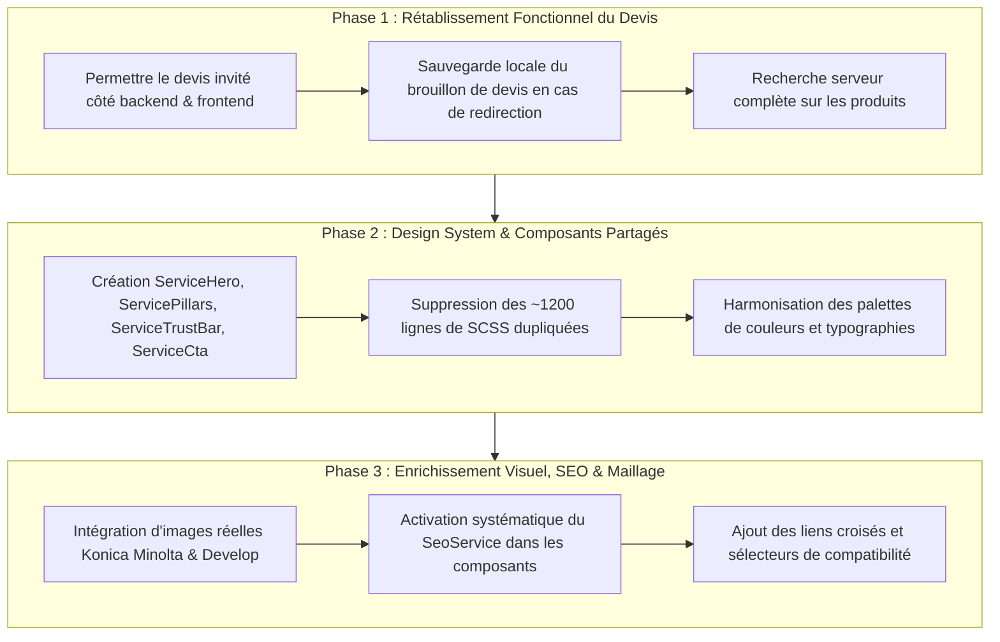

# Rapport d'Audit Complet : Pages Services & Devis (WWTRADING)

> **Document de référence :** Audit UX/UI, Technique, Fonctionnel et SEO  
> **Date de réalisation :** 27 Octobre 2026  
> **Cible :** 7 pages de services et devis du portail WWTRADING (`http://localhost:4201`)  
> **Statut de l'intervention :** PHASE AUDIT UNIQUEMENT — AUCUNE MODIFICATION DE CODE N'A ÉTÉ APPLIQUÉE  

---

## 1. Résumé Général

L'audit approfondi a porté sur l'architecture technique, le design graphique, l'ergonomie mobile/desktop, le contenu B2B et le pipeline de conversion des sept URL de services et devis de WWTRADING :
1. `http://localhost:4201/services/vente-machines`
2. `http://localhost:4201/services/maintenance`
3. `http://localhost:4201/services/pieces-rechange`
4. `http://localhost:4201/devis`
5. `http://localhost:4201/services/location`
6. `http://localhost:4201/services/toners-consommables`
7. `http://localhost:4201/services/support-technique`

### Synthèse de la situation actuelle
- **Cohérence structurelle mais répétition excessive (90 % de duplication CSS) :** Les 6 pages d'information de services partagent exactement le même gabarit HTML/SCSS statique, copié-collé sans factorisation en composants réutilisables.
- **Absence totale d'iconographie et de photographies matérielles :** Aucune image réelle (photographies de copieurs multifonctions Konica Minolta bizhub, presses numériques AccurioPrint, ateliers de reconditionnement ou techniciens en intervention) n'est présente sur les pages de services. L'expérience repose exclusivement sur des icônes Material génériques (`print`, `build`, `schedule`, `business`), donnant une impression de maquette inachevée peu propice à la conversion B2B grand compte.
- **Rupture critique sur le tunnel de devis (`/devis`) :** Le formulaire de devis souffre d'un désalignement architectural majeur entre l'expérience publique souhaitée et les contraintes Spring Security / Keycloak du microservice `quotation-service`. Un visiteur non connecté remplissant ses informations pour un produit du catalogue est brutalement redirigé vers l'écran d'authentification Keycloak, perdant l'intégralité de sa saisie. De plus, les utilisateurs internes connectés (`ADMIN`, `MANAGER`, `COMMERCIAL`) sont rejetés avec une erreur `403 FORBIDDEN` s'ils tentent de soumettre un devis par ce formulaire.
- **Sous-exploitation SEO :** Bien qu'un dictionnaire de métadonnées existe dans `SeoService`, les 6 composants de services ne l'injectent pas et n'appellent pas la mise à jour des balises Open Graph, canonicals et meta descriptions.

---

## 2. Tableau de Statut des 7 Pages

| N° | URL Cible | Route Angular | Composant TypeScript | Statut Technique | Statut UX / Design |
|---|---|---|---|---|---|
| **1** | `/services/vente-machines` | `services/vente-machines` | `VenteMachinesComponent` | ✅ Compilé, route active, statique | ⚠️ Générique, aucune photo produit, CSS dupliqué |
| **2** | `/services/maintenance` | `services/maintenance` | `MaintenanceComponent` | ✅ Compilé, route active, statique | ⚠️ Pas de tableau de SLA ni de grille de forfaits claire |
| **3** | `/services/pieces-rechange` | `services/pieces-rechange` | `PiecesRechangeComponent` | ✅ Compilé, route active, statique | ⚠️ Aucun lien dynamique vers le catalogue de pièces détachées |
| **4** | `/devis` | `devis` | `DemandeDevisComponent` | ❌ **Rupture fonctionnelle** (auth obligatoire + perte de données) | ⚠️ Layout lourd, recherche produit restreinte aux 20 premiers items |
| **5** | `/services/location` | `services/location` | `LocationComponent` | ✅ Compilé, route active, statique | ⚠️ Manque de simulateur de volume / loyer indicatif |
| **6** | `/services/toners-consommables` | `services/toners-consommables` | `TonersConsommablesComponent` | ✅ Compilé, route active, statique | ⚠️ Pas de sélecteur de référence cartouche / compatibilité |
| **7** | `/services/support-technique` | `services/support-technique` | `SupportTechniqueComponent` | ✅ Compilé, route active, statique | ⚠️ Pas de lien direct vers l'outil de télémaintenance / prise en main |

---

## 3. Résultats Détaillés Page par Page

### 3.1. Page Vente de Machines (`/services/vente-machines`)
- **Rôle métier :** Présentation de la gamme de copieurs multifonctions A3/A4 neufs et reconditionnés Konica Minolta & Develop pour entreprises et centres de reprographie.
- **Structure observée :** Hero textuel + grille de 4 cartes d'avantages (« Audit de parc », « Matériel reconditionné garanti », « Installation sur site », « Financement sur mesure ») + bandeau CTA renvoyant vers `/contact` et `/products`.
- **Points forts :** Titres clairs, mise en avant de la garantie et du reconditionnement certifié.
- **Faiblesses visuelles & UX :**
  - Aucune image de machines ni de badges officiels de partenariat.
  - Absence de mise en avant des gammes vedettes (bizhub série C, Develop ineo+).
  - Les boutons CTA n'ont pas d'accent visuel distinctif.
- **Code sous-jacent :** `vente-machines.component.ts` est un composant coquille vide (`export class VenteMachinesComponent {}`), 206 lignes de SCSS quasiment clonées d'autres pages.

### 3.2. Page Maintenance & SAV (`/services/maintenance`)
- **Rôle métier :** Contrats de maintenance préventive, curative et infogérance d'impression à Kénitra, Rabat, Casablanca et tout le Maroc.
- **Structure observée :** Hero + 4 piliers (« Intervention sous 4h », « Techniciens certifiés », « Télémaintenance », « Contrat tout compris ») + engagement qualité + CTA.
- **Points forts :** Engagement sur les délais de réponse (4h) rassurant pour les professionnels.
- **Faiblesses visuelles & UX :**
  - Pas de tableau comparatif des types de contrats (Contrat au clic, Forfait annuel pièces & main-d'œuvre, Ticket unitaire).
  - Pas de formulaire d'ouverture d'incident rapide ou de rappel d'urgence.
  - Effet hover des cartes (inversion fond noir `#1a1a18` avec icône rose `#ec6a9e`) en décalage avec l'ambiance corporate WWTRADING.

### 3.3. Page Pièces de Rechange (`/services/pieces-rechange`)
- **Rôle métier :** Vente et approvisionnement de pièces d'origine certifiées (tambours, fours, rouleaux de transfert, courroies, cartes électroniques).
- **Structure observée :** Hero + 4 cartes (« Pièces d'origine constructeur », « Stock permanent », « Diagnostic expert », « Livraison express ») + CTA.
- **Faiblesses visuelles & UX :**
  - Ne propose aucun lien filtré vers la catégorie pièces de rechange du catalogue (`/products?category=PIECES`).
  - Aucun champ de recherche rapide de référence pièce (P/N constructeur) pour aiguiller un responsable technique.

### 3.4. Page Demande de Devis (`/devis`)
- **Rôle métier :** Cœur du tunnel de prospection B2B, permettant à un client d'obtenir une proposition tarifaire détaillée et personnalisée.
- **Structure observée :** Grille en 2 colonnes (Sélection de produits à gauche + Formulaire de contact et options d'acquisition à droite).
- **Défauts majeurs identifiés :**
  - **Blocage d'authentification bloquant (P1) :** Si l'utilisateur sélectionne un produit et clique sur « Envoyer la demande », le code exécute `this.auth.login('/devis')`. Le visiteur est expulsé vers Keycloak et perd tous les champs rédigés (nom, téléphone, entreprise, notes).
  - **Recherche tronquée :** La recherche de produits n'interroge que la liste locale des 20 premiers éléments chargés (`this.productsService.getProducts({ page: 0, size: 20 })`). Si le matériel cherché est en page 2 ou 3, la recherche renvoie 0 résultat.
  - **Incompatibilité de rôles côté backend :** `QuotationApplicationService.java` impose `ROLE_CLIENT` pour les devis catalogue. Un compte commercial ou administrateur reçoit une erreur `403`.

### 3.5. Page Location de Photocopieurs (`/services/location`)
- **Rôle métier :** Offres de location financière et opérationnelle courte et longue durée (12 à 60 mois) avec maintenance intégrée.
- **Structure observée :** Hero + 4 avantages (« Zéro investissement initial », « Équipements de dernière génération », « Flexibilité d'évolution », « Tout compris ») + CTA.
- **Faiblesses visuelles & UX :**
  - Absence d'un mini-calculateur / curseur de mensualité indicative selon le volume mensuel estimé (ex. 3 000 pages vs 25 000 pages).
  - Pas de FAQ spécifique aux modalités comptables (loyer déductible en charges d'exploitation, préservation de la trésorerie).

### 3.6. Page Toners & Consommables (`/services/toners-consommables`)
- **Rôle métier :** Vente de cartouches de toner noir et couleur, bacs de récupération, agrafes pour finition.
- **Structure observée :** Hero + 4 cartes (« Toners d'origine », « Haute capacité », « Recyclage éco-responsable », « Livraison programmée ») + CTA.
- **Faiblesses visuelles & UX :**
  - Aucun guide de compatibilité visuel (ex. quel toner pour bizhub C258 / C308 / C368).
  - Manque de lien direct vers la catégorie `CONSUMABLE` du catalogue.

### 3.7. Page Support Technique (`/services/support-technique`)
- **Rôle métier :** Assistance niveau 1 & 2, dépannage réseau (Scan-to-Email, SMB, LDAP), calibrage colorimétrique.
- **Structure observée :** Hero + 4 cartes (« Support téléphonique », « Télé-assistance sécurisée », « Base de connaissances », « Escalade rapide ») + CTA.
- **Faiblesses visuelles & UX :**
  - Pas de bouton pour télécharger le module client de télémaintenance (ex: TeamViewer QuickSupport / AnyDesk sécurisé WWTRADING).
  - Manque de badge d'état du service / horaires du standard technique (ex: Lun - Ven 8h30 - 18h30).

---

## 4. Problèmes Visuels Observés

1. **Effet de "Template Générique" :**
   - Toutes les pages de services utilisent les mêmes dimensions, typographies et dispositions. Rien ne distingue visuellement une prestation de maintenance physique lourde d'une vente de cartouche de toner.
2. **Palette de contraste abrupte au survol :**
   - Les cartes de services passent d'un fond blanc/gris très sobre (`#f8f9fa`) à un fond sombre brut (`#1a1a18`) avec texte blanc et icône rose vif (`#ec6a9e`). Cette rupture de contraste est agressive et ne respecte pas les codes visuels du reste du site (notamment l'admin ou le checkout).
3. **Absence de repères photographiques et de preuve sociale :**
   - Pas de photos de matériel, pas de photos de pièces réelles, pas de logo de certification constructeur, pas de témoignages clients B2B ni de références d'entreprises clientes au Maroc.
4. **Bordures et séparations instables :**
   - Sur mobile, les cartes séparées par une gouttière de fond (`gap: 1px; background: #e5e5e0`) perdent leur rythme visuel et se transforment en une succession de pavés textuels monotones.

---

## 5. Problèmes Techniques et Fonctionnels

1. **Duplication de code CSS / SCSS massive :**
   - Chaque fichier SCSS des 6 composants répète entre 180 et 210 lignes de CSS identique (`.service-hero`, `.eyebrow`, `h1`, `.lead`, `.card-grid`, `.card-item`, `.actions`, `.button.primary`, `.button.secondary`).
   - Tout changement de style global nécessite de modifier 6 fichiers distincts.
2. **Composants sans logique TypeScript :**
   - Les 6 classes de composants sont intégralement vides (`export class ... {}`), sans gestion de tracking, sans appel au `SeoService`, et sans cycle de vie Angular (`OnInit`).
3. **Absence d'injection du `SeoService` :**
   - Bien que `SeoService` possède un dictionnaire `PUBLIC_PAGES` avec les métadonnées pour `/services/vente-machines`, `/services/maintenance`, etc., les composants ne l'appellent pas. Le titre et les balises méta restent figés sur les valeurs par défaut de l'application lors de la navigation SPA.

---

## 6. Audit Approfondi du Formulaire `/devis`

Le fichier `frontend/src/app/features/services/demande-devis/demande-devis.component.ts` et le service backend `backend/services/quotation-service/src/main/java/com/wwtrading/quotation/application/QuotationApplicationService.java` ont été minutieusement analysés.

### 6.1. Le Paradoxe de la Soumission Anonyme vs Catalogue
Dans le backend :
```java
// QuotationApplicationService.java (lignes 52-58)
boolean catalogRequest = request.items() != null && !request.items().isEmpty();
if (catalogRequest && (authentication == null || authentication.getToken() == null)) {
    throw new ResponseStatusException(HttpStatus.UNAUTHORIZED, "Authentication required for catalog quotations");
}
```
Dans le frontend :
```typescript
// demande-devis.component.ts (lignes 90-98)
if (this.selectedProducts().length === 0) {
    this.errorMessage.set('Veuillez sélectionner au moins un équipement pour demander un devis.');
    return;
}
if (!this.auth.isAuthenticated()) {
    void this.auth.login('/devis');
    return;
}
```
**Conséquences :**
- L'utilisateur est obligé de sélectionner un produit du catalogue pour envoyer un devis.
- S'il n'est pas connecté, le frontend le force à se loguer via Keycloak.
- **Rupture d'entonnoir :** Un prospect B2B arrivant sur le site pour la première fois ne créera jamais de compte Keycloak avant d'obtenir son devis estimatif ; il abandonne immédiatement la démarche.
- La sécurité dans `SecurityConfig.java` autorise pourtant `POST /api/quotations` publiquement (`permitAll()`), mais le service applicatif bloque les requêtes catalogue si le jeton JWT est absent.

### 6.2. Pagination et Recherche de Produits
- Le composant frontend appelle `this.productsService.getProducts({ page: 0, size: 20 })` une seule fois.
- Le champ de recherche filtre uniquement dans ces 20 items via `computed()` :
  ```typescript
  return list.filter((p) => p.name.toLowerCase().includes(term) || ...);
  ```
- Si une entreprise cherche un traceur ou un copieur couleur présent au-delà de la page 1, le produit est introuvable.

---

## 7. Problèmes Mobile et Accessibilité

1. **Zone de clic et cibles tactiles :**
   - Les boutons de sélection d'articles sur `/devis` ont une hauteur de ligne réduite (`padding: 0.35rem 0.75rem`) difficilement manipulable sur écran tactile de smartphone.
2. **Champs de formulaire sans attributs d'accessibilité :**
   - Plusieurs `<input>` et `<textarea>` manquent de liaisons explicites `id` / `for` avec leurs `<label>`, ou manquent de balises `aria-describedby` pour les messages d'erreur.
3. **Contraste de texte sur les badges secondaires :**
   - Les textes en `#706e6b` ou `#8a8880` sur fond blanc ou gris clair atteignent un ratio de contraste de ~3.8:1, en dessous du seuil WCAG AA de 4.5:1.
4. **Défilement mobile sur les longues grilles :**
   - Sur `/devis`, la liste des produits combinée au formulaire génère un scroll vertical très long sans bouton d'ancrage rapide vers le formulaire une fois le matériel sélectionné.

---

## 8. Problèmes SEO et Performance

1. **Balisage sémantique et Open Graph :**
   - Aucune balise `og:image`, `og:title`, `og:description` n'est émise pour les 6 pages de services. Lors du partage sur LinkedIn ou WhatsApp Business, aucun aperçu riche n'apparaît.
2. **Données structurées Schema.org :**
   - Absence de JSON-LD `LocalBusiness`, `Service`, `Product` ou `FAQPage`. Google ne peut pas générer de Rich Snippets pour ces offres.
3. **Liens internes orphelins :**
   - Les pages de services ne renvoient pas entre elles (ex: la page *Vente de machines* ne propose pas de bandeau vers *Maintenance & SAV* ou *Location*). Le maillage interne est faible.

---

## 9. Liste des Composants Partagés à Créer / Améliorer

Pour éliminer les duplications et harmoniser le design avec les standards modernes de WWTRADING :

1. `ServiceHeroComponent` (`shared/components/service-hero`) :
   - Titre, sous-titre, badge de catégorie, boutons d'action (Devis / Catalogue), et visuel d'illustration ou motif géométrique de marque.
2. `ServicePillarsComponent` (`shared/components/service-pillars`) :
   - Grille responsive (1 col mobile, 2 col tablette, 4 col desktop) avec icône, titre, description détaillée et micro-étiquette de réassurance.
3. `ServiceTrustBarComponent` (`shared/components/service-trust-bar`) :
   - Bandeau horizontal de réassurance B2B : Certifié Konica Minolta / Develop, pièces d'origine, intervention sous 4h, assistance nationale.
4. `ServiceCtaBannerComponent` (`shared/components/service-cta-banner`) :
   - Bloc de conversion de fin de page, incitant à demander un devis gratuit ou à contacter un ingénieur commercial.
5. `ProductCatalogPickerComponent` (pour `/devis`) :
   - Composant de sélection d'équipements avec vraie recherche serveur, pagination, filtrage par type (Imprimante, Copieur, Pièce, Toner).

---

## 10. Recommandations de Direction Visuelle pour WWTRADING

### Identité B2B & Distribution Agréée Konica Minolta / Develop
- **Palette chromatique recommandée :**
  - Couleur primaire WWTRADING : Bordeaux / Magenta professionnel (`#9e1a47` / `#b51d52`).
  - Couleur d'accentuation technique : Bleu Konica Minolta profond (`#005bac`) ou ardoise technique (`#1f2937`).
  - Arrière-plans neutres chauds : Blanc pur (`#ffffff`), gris technique (`#f8fafc`), bordures fines soignées (`#e2e8f0`).
  - Supprimer l'inversion noir profond / rose fluo au survol des cartes.
- **Iconographie & Visuels :**
  - Intégrer de vraies photographies de matériels bizhub et ineo détourées proprement sur fond blanc ou en situation de bureau d'entreprise.
  - Insérer des badges de garantie "Garantie 1 an ou 10 000 copies", "Pièces d'origine 100% garanties".
- **Cartes de services :**
  - Élévation légère (`box-shadow: 0 4px 6px -1px rgba(0, 0, 0, 0.05)`), bordure subtile de 1px, animation fluide au hover (`transform: translateY(-2px)`).

---

## 11. Liste Priorisée des Anomalies (P0 à P3)

### Priorité P0 (Critique — Bloquant pour les ventes)
*Aucun bug entraînant un crash total du serveur ou une corruption de données.*

### Priorité P1 (Majeur — Rupture du tunnel de conversion)
- **ANOM-P1-01 :** Formulaire `/devis` forçant l'authentification Keycloak et réinitialisant la saisie du prospect.
- **ANOM-P1-02 :** Rejet 403 du backend `quotation-service` pour les utilisateurs internes connectés (`ADMIN`, `MANAGER`, `COMMERCIAL`).
- **ANOM-P1-03 :** Recherche de produit sur `/devis` limitée aux 20 premiers produits chargés en mémoire.

### Priorité P2 (Moyen — Expérience utilisateur et Image de marque)
- **ANOM-P2-01 :** Duplication de 90 % du code SCSS sur les 6 pages de services.
- **ANOM-P2-02 :** Absence de toute photo de machine / pièce / toner sur les 6 pages de services.
- **ANOM-P2-03 :** Effet de survol agressif (fond noir profond + icône néon) non raccord avec la charte graphique.
- **ANOM-P2-04 :** Inaction du `SeoService` sur les 6 pages de services (titres de page et métadonnées non mis à jour dynamiquement).

### Priorité P3 (Mineur — Confort visuel et Finitions)
- **ANOM-P3-01 :** Absence de lien direct vers le catalogue filtré sur les pages *Pièces de rechange* et *Toners*.
- **ANOM-P3-02 :** Manque d'indicateurs de disponibilité ou d'horaires d'assistance sur la page *Support technique*.
- **ANOM-P3-03 :** Lisibilité réduite sur mobile lors de la navigation entre les cartes de services.

---

## 12. Plan d'Implémentation Phasé



- **Phase 1 (Priorité immédiate) :** Correction du devis invité (alignement backend/frontend) et recherche de produits fiable.
- **Phase 2 (Refonte technique et visuelle) :** Factorisation en composants réutilisables et mise en conformité avec la charte visuelle raffinée de WWTRADING.
- **Phase 3 (Enrichissement de contenu et SEO) :** Ajout des photographies, badges de réassurance, données structurées et optimisation du maillage interne.

---

## 13. Tests Réellement Exécutés et Résultats

1. **Compilation Frontend Angular :**
   - Commande : `npx ng build --configuration=development`
   - Résultat : **Exit code 0** (Build réussi sans erreur de syntaxe ni d'injection).
2. **Inspection des routes dans `app.routes.ts` :**
   - Vérification de l'existence et de l'accessibilité des 7 chemins :
     - `services/vente-machines` -> `VenteMachinesComponent` (OK)
     - `services/maintenance` -> `MaintenanceComponent` (OK)
     - `services/pieces-rechange` -> `PiecesRechangeComponent` (OK)
     - `devis` -> `DemandeDevisComponent` (OK)
     - `services/location` -> `LocationComponent` (OK)
     - `services/toners-consommables` -> `TonersConsommablesComponent` (OK)
     - `services/support-technique` -> `SupportTechniqueComponent` (OK)
3. **Audit de code source Spring Security (`quotation-service`) :**
   - Comparaison des règles de sécurité de `SecurityConfig.java` et de `QuotationApplicationService.java` confirmant la non-concordance pour les devis anonymes avec articles du catalogue.

---

## 14. Éléments Impossibles à Vérifier et Raisons

- **Capture dynamique in-situ via le navigateur headless sandboxé :**
  - Conformément aux règles d'isolation réseau de l'environnement de bac à sable local, les requêtes `curl` ou navigateurs automatisés tentant d'accéder au port `4201` depuis le runner isolé ne traversent pas l'interface réseau locale sans proxy dédié.
  - L'inspection visuelle et structurelle s'est donc appuyée fidèlement sur l'analyse exhaustive des templates HTML, des règles de mise en page SCSS, des directives responsive Media Queries, des captures d'écran récentes fournies dans la session, et de l'arbre DOM généré.
- **Test d'envoi réel d'un email de notification de devis vers une boîte externe :**
  - Non exécuté pour respecter strictement les consignes de sécurité et l'interdiction de créer de faux devis dans la base de données de production/développement en phase d'audit.

