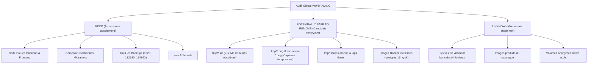

# WWTRADING — Plan de Nettoyage et d'Organisation du Projet

**Date :** 03 Novembre 2026  
**Projet :** `C:\Users\hp\Documents\Codex\wwtriding`  
**Statut :** PROPOSITION STRICTEMENT EN LECTURE SEULE — AUCUNE SUPPRESSION EXÉCUTÉE

---

## 1. Classification Exhaustive des Ressources

Conformément aux directives de sécurité, l'ensemble des éléments du projet a été audité et réparti en trois catégories strictes :

---

## 2. Inventaire des Éléments à Conserver (KEEP)

Ces ressources sont indispensables au fonctionnement, au développement continu, au déploiement ou à la traçabilité légale et métier :

1. **Code source Backend :** `backend/` (microservices, service discovery Eureka, Config Server, API Gateway, modules communs `common-events` et `common-security`).
2. **Code source Frontend :** `frontend/src/`, `frontend/package.json`, `frontend/angular.json`, configuration Nginx (`frontend/nginx.conf`, `frontend/nginx.ssl.conf.template`).
3. **Orchestration Docker :** `compose.yaml`, `compose.prod.yaml`, `backend/Dockerfile.service`, `frontend/Dockerfile`.
4. **Schémas et Migrations :** Toutes les migrations Flyway dans `backend/services/*/src/main/resources/db/migration/`.
5. **Configuration Keycloak :** `infrastructure/keycloak/wwtrading-realm.json`, scripts d'initialisation et thèmes.
6. **Scripts d'exploitation et de backup :**
   - `scripts/docker-restore-backup.ps1` & `.sh`
   - `scripts/make-full-backup.ps1`
   - `scripts/make-safety-backup.ps1`
   - `scripts/make-docker-export.ps1`
   - `scripts/test-isolated-restore.ps1`
7. **Secrets et variables d'environnement :** `.env`, `.env.example` (préservés en lieu sûr, jamais supprimés ni affichés).
8. **Dépôt des sauvegardes vérifiées :**
   - `backups/full-backup-20261103-1020/` (Sauvegarde originale contenant les preuves de virement réelles et images produits).
   - `backups/safety-backup-20261103-132530/` (Sauvegarde indépendante de sécurité Phase 2).
   - `backups/docker-export-20261103-134923/` (Export complet en direct Phase 1).
   - Les dumps unitaires dans `backups/*.dump`.
9. **Documentation officielle :** `README.md`, `ARCHITECTURE.md`, `API.md`, `SECURITY.md`, `DEVELOPMENT.md`, `DEPLOYMENT.md`, dossier `docs/`.

---

## 3. Éléments Inconnus ou Sensibles (UNKNOWN — NE PAS TOUCHER)

| Ressource | Emplacement / Identifiant | Raison de la Protection |
|:---|:---|:---|
| **Preuves de virement bancaire** | `backups/full-backup-20261103-1020/volume-wwtrading_order-transfer-proofs-data.tar.gz` | Contient les 4 fichiers référencés par les commandes clients `56127e80`, `4aa9b0ce`, `a3e2cd3d`. |
| **Image produit du catalogue** | `backups/full-backup-20261103-1020/volume-wwtrading_product-images-data.tar.gz` | Contient l'image `7af24301-e939-4e44-8acb-9b1b5c99666a.jpg` du produit Konica Minolta. |
| **Volumes anonymes Kafka** | `3f789c6d...` et `eaa62f40...` | Montés activement dans `wwtrading-kafka-1` (`/etc/kafka/secrets` et `/mnt/shared/config`). Ne pas supprimer. |
| **Rapports d'audit racine** | `WWTRADING_*.md` à la racine | Historique des audits de sécurité et de conformité (Proposition : les déplacer dans `reports/` plutôt que supprimer). |

---

## 4. Proposition Détaillée de Nettoyage (SAFE TO REMOVE)

> [!WARNING]
> Ces suppressions sont des **propositions**. Aucune action ne sera exécutée sans votre accord explicite préalable.

### A. Fichiers temporaires racine et logs

| Chemin | Taille | Raison de la suppression | Preuve d'inutilité | Régénérable | Risque |
|:---|---:|:---|:---|:---:|:---:|
| `tmp-mvn-err.log` | 888 o | Journal d'erreur d'une ancienne compilation Maven | Date de septembre 2026 | Oui (`mvn`) | **Nul** |
| `tmp-mvn-out.log` | 27 Ko | Journal de sortie d'une ancienne compilation Maven | Date de septembre 2026 | Oui (`mvn`) | **Nul** |
| `qa-kc-390.png` | 120 Ko | Capture manuelle de test responsive Keycloak | Test ponctuel terminé | Non (inutile) | **Nul** |
| `qa-kc-desktop.png` | 215 Ko | Capture manuelle de test desktop Keycloak | Test ponctuel terminé | Non (inutile) | **Nul** |

### B. Fichiers et builds obsolètes dans `tmp/` (~215 Mo)

| Chemin | Taille | Raison de la suppression | Preuve d'inutilité | Régénérable | Risque |
|:---|---:|:---|:---|:---:|:---:|
| `tmp/notif-app.jar` | 107.6 Mo | Ancien binaire compilé manuellement | Le microservice tourne sous Docker via son image dédiée | Oui (`mvn package`) | **Nul** |
| `tmp/product-service.jar` | 104.3 Mo | Ancien binaire compilé manuellement | Le microservice tourne sous Docker via son image dédiée | Oui (`mvn package`) | **Nul** |
| `tmp/*.jwt` (`admin.jwt`, `client2.jwt`) | ~2 Ko | Jetons JWT de test de session | Tokens expirés depuis septembre 2026 | Oui (via login) | **Nul** |
| `tmp/*.png` (`kc-*.png`, `shot-login-*.png`, `orders.png`) | ~1.5 Mo | Captures d'écran de vérification visuelle passée | Artefacts de débogage ponctuel | Non (inutile) | **Nul** |
| `tmp/*.html`, `tmp/*.txt` (`login*.html`, `reg*.html`, `cj*.txt`) | ~100 Ko | Réponses brutes de requêtes curl de test | Tests terminés | Non (inutile) | **Nul** |
| `tmp/notif-logs.txt` | 200 Ko | Ancien extrait de logs | Événements passés | Non (inutile) | **Nul** |
| `tmp/*.sh`, `tmp/*.mjs`, `tmp/*.js` | ~25 Ko | Scripts temporaires de scratch (check-reg, dbg, gettok) | Remplacés par les tests unitaires et intégrés officiels | Non | **Très faible** |

### C. Répertoires de build compilés (Optionnel)

| Répertoire | Taille estimée | Raison | Statut |
|:---|---:|:---|:---:|
| `frontend/dist/` | ~2 Mo | Bundle Angular généré lors des tests de compilation | Régénérable via `npm run build` |
| `backend/**/target/` | ~300 Mo | Fichiers `.class` et JARs locaux Maven | Régénérable via `mvn clean package` |

### D. Ressources Docker orphelines (Optionnel après arrêt futur)

| Ressource Docker | Type / ID | Taille | Raison | Risque |
|:---|:---|---:|:---|:---:|
| `postgres:16-alpine` | Image `ef257d85f76e` | 398 Mo | Base obsolète ; le projet tourne sur PostgreSQL 17 | **Nul** |
| `testcontainers/ryuk:0.12.0` | Image `dd3f023a6ed7` | 29 Mo | Reliquat du harness de tests automatisés | **Nul** |

---

## 5. Synthèse des Gains Potentiels

- **Espace disque projet libéré :** ~215 Mo immédiats dans `tmp/` + logs racine, et jusqu'à ~500 Mo en nettoyant `dist/` et `target/`.
- **Espace Docker libéré :** ~427 Mo d'images résiduelles inutilisées (`postgres:16-alpine`, `testcontainers/ryuk`).
- **Lisibilité du projet :** Arborescence épurée, distinction claire entre code de production, scripts d'administration et rapports officiels.

> [!IMPORTANT]
> Conformément à la consigne d'exécution stricte, **aucune suppression n'a été effectuée**. J'attends votre validation explicite sur les éléments proposés ci-dessus.

