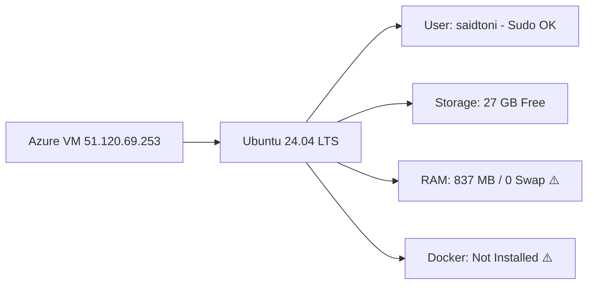

# WWTRADING — Comprehensive CI/CD & Azure VM Host Inspection Report

**Date:** 2026-11-04  
**Project Path:** `C:\Users\hp\Documents\Codex\wwtriding`  
**GitHub Repository:** `https://github.com/saidelhabhab/wwtrading.git` (Default branch: `main`)  
**Deployment Target:** Azure Linux VM (`51.120.69.253`)  
**SSH User Confirmed:** `saidtoni`  
**Local SSH Key:** `C:\Users\hp\Downloads\vmforwwtrading_key.pem` (Verified: 2,498 bytes, secure ACL applied)

---

## 1. Executive Summary

- **Local Git Environment:** Git repository initialized (`main` branch). `.gitignore` hardened with strict zero-leak rules. Verified that `.env`, `backups/`, `*.dump`, `*.pem`, `*.key` are completely excluded and will never be tracked or committed.
- **GitHub Remote:** `https://github.com/saidelhabhab/wwtrading.git` is active, connected as `origin`, and currently clean/empty.
- **Azure VM Connectivity:** Successfully connected via SSH using `saidtoni@51.120.69.253`. Passwordless sudo is functional.
- **CRITICAL HOST FINDING — Hardware Constraints:**
  - **OS:** Ubuntu 24.04.1 LTS (Kernel 7.0.0-1017-azure x86_64).
  - **CPU:** 1 vCPU.
  - **RAM:** **837 MB total RAM (0 MB Swap)**.
  - **Disk:** 27 GB available on `/dev/root`.
  - **Docker Status:** Docker Engine and Docker Compose are **not installed** yet.
  - **Capacity Risk:** The WWTRADING platform comprises **25 Docker containers** (12 Spring Boot Java 21 microservices, 10 PostgreSQL instances, Keycloak, Kafka, MailHog, Nginx frontend). Running this entire stack requires a minimum of **4 GB to 8 GB RAM**. A 837 MB VM will trigger immediate Linux OOM-Killer crashes during Docker build or startup unless resized and/or configured with swap.

---

## 2. Security Audit & Zero-Leak Verification

### 2.1 Hardened `.gitignore`
The `.gitignore` has been updated with bulletproof patterns:
```gitignore
# Environment and secrets
.env
.env.*
!.env.example
*.local
*.pem
*.key
*.id_rsa
*.pub

# Backups and Database Dumps
backups/
*.dump
*.sql
*.tar
*.tar.gz
*.tgz
```

### 2.2 Proof of Exclusion
Automated test with `git check-ignore -v`:
- `.env` -> IGNORED (line 2)
- `backups/` -> IGNORED (line 12)
- `backups/wwtrading-product-db-1.dump` -> IGNORED (line 12)
- `test.pem` -> IGNORED (line 6)
- `test.key` -> IGNORED (line 7)

The local private key `C:\Users\hp\Downloads\vmforwwtrading_key.pem` remains in `Downloads` and is NEVER moved or copied into the repository.

---

## 3. Azure VM Host Audit & Readiness



### 3.1 Host Inspection Output
- `uname -a`: `Linux vmforwwtrading 7.0.0-1017-azure #17~24.04.1-Ubuntu SMP x86_64`
- `whoami`: `saidtoni`
- `sudo -n whoami`: `root` (Passwordless sudo confirmed)
- `free -m`: Total 837 MB, Available 609 MB, Swap 0 MB
- `df -h`: `/dev/root` 29 GB total, 27 GB available (7% used)
- `docker`: `command not found`

### 3.2 Required VM Adjustments
1. **Docker Engine Installation:**
   Install official Docker Engine (`docker-ce`, `docker-ce-cli`, `containerd.io`, `docker-compose-plugin`) and add `saidtoni` to the `docker` group.
2. **RAM & Swap Management:**
   - **Recommended:** Resize VM in Azure Portal to at least `Standard_B2ms` (2 vCPU, 8 GB RAM) or `Standard_B2s` (2 vCPU, 4 GB RAM).
   - **Immediate mitigation on current VM:** Create a 4 GB swapfile (`/swapfile`) to provide memory headroom for builds and container startup.

---

## 4. Pipeline Design (CI/CD)

The GitHub Actions workflow `.github/workflows/ci.yml` will be enhanced with a deployment stage:

1. **Stage 1: Validation (CI)**
   - Secret scan via Gitleaks.
   - Java 21 Maven build & test (`mvn --batch-mode verify`).
   - Frontend Angular build (`pnpm install --frozen-lockfile && pnpm build`).
   - Filesystem security scan via Trivy.

2. **Stage 2: Continuous Deployment (CD - on push to `main` only)**
   - Connects to Azure VM `51.120.69.253` via SSH using `secrets.AZURE_VM_SSH_KEY`.
   - Clones or updates repository in `/home/saidtoni/wwtrading`.
   - Generates production `.env` from template.
   - Idempotently creates persistent Docker volumes (`wwtest_*`).
   - Executes `docker compose --profile prod up -d --build`.
   - Performs curl health checks on port 80 (Nginx frontend), port 8080 (API Gateway), and port 8180 (Keycloak).

---

## 5. Next Steps

1. **GitHub Setup:**
   - Verify repository privacy (Private).
   - Add GitHub Secrets:
     - `AZURE_VM_HOST`: `51.120.69.253`
     - `AZURE_VM_USER`: `saidtoni`
     - `AZURE_VM_SSH_KEY`: Content of `C:\Users\hp\Downloads\vmforwwtrading_key.pem`
2. **Initial Commit & Push:**
   - Stage and commit the project codebase to `main`.
   - Push to `origin main`.
3. **Azure VM Provisioning:**
   - Install Docker & Compose on the VM.
   - Enable 4GB swap on the VM.
   - Decide on VM resize (recommended for 25 microservices).
