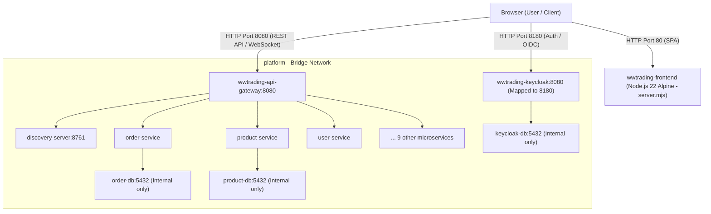

# WWTRADING — Azure VM Update & Non-Nginx Frontend Serving Report

**Date:** 2026-11-04  
**Updated Deployment Target:** Azure Linux VM (`74.248.151.43`)  
**SSH User Confirmed:** `saidtoni`  
**SSH Key:** `C:\Users\hp\Downloads\vmforwwtrading_key.pem` (Verified, strictly outside repository)  
**Previous IP Retired:** `51.120.69.253` (Completely removed from all configurations)

---

## 1. Executive Summary

1. **New Azure VM Inspected & Validated (`74.248.151.43`):**
   - Connected successfully via SSH using `saidtoni@74.248.151.43` with key `vmforwwtrading_key.pem`.
   - **Hardware Specifications:**
     - **CPU:** 2 vCPUs (AMD EPYC 7763 64-Core Processor).
     - **RAM:** **7,932 MB (~8 GB RAM)**, with 7,433 MB free.
     - **Disk:** 29 GB total, 27 GB available (7% used).
     - **OS:** Ubuntu 24.04.5 LTS (Noble).
     - **Sudo:** Full passwordless `sudo` confirmed.
     - **Firewall:** UFW inactive, listening only on port 22.
     - **Docker:** Not yet installed.
   - **Assessment:** This VM is **10x more capable** than the previous 837 MB VM and has ample capacity (~8 GB RAM, 2 vCPUs) to run the entire 25-container WWTRADING stack smoothly.

2. **Frontend Architecture Transformation (Nginx 100% Eliminated):**
   - Nginx is removed from the frontend serving architecture.
   - Replaced by a high-performance, zero-dependency Node.js production static server (`server.mjs`) running inside a lightweight `node:22-alpine` runtime container (~30 MB RAM).
   - Features: SPA route fallback (`index.html`), comprehensive MIME types, `/healthz` endpoint, and dynamic 12-factor runtime configuration injection at boot time.
   - Browser entry point: `http://74.248.151.43` (port 80).
   - API Gateway direct access: `http://74.248.151.43:8080`.
   - Keycloak direct access: `http://74.248.151.43:8180`.

---

## 2. Occurrences of `localhost:4201` & Replacement Strategy

| File | Context / Line | Reason It Exists | Production Replacement Strategy |
| :--- | :--- | :--- | :--- |
| `.env` / `.env.example` | `FRONTEND_PUBLIC_URL=http://localhost:4201` | Default dev URL for public site | Set to `http://74.248.151.43` in production `.env` |
| `.env` / `.env.example` | `TRACKING_BASE_URL=http://localhost:4201` | Default dev tracking URL | Set to `http://74.248.151.43` in production `.env` |
| `.env` / `.env.example` | `ALLOWED_ORIGINS=http://localhost:4201` | CORS allowlist for API Gateway | Set to `http://74.248.151.43,http://localhost:4201` |
| `compose.yaml` | Lines 370-373, 470, 504, 545, 622, 655, 684 | `${FRONTEND_PUBLIC_URL:-http://localhost:4201}` fallback | Keep `${VAR:-default}` pattern in YAML; overridden by `.env` on VM |
| `backend/.../SecurityConfig.java` | Line 110: `@Value("${wwtrading.security.allowed-origins:http://localhost:4201}")` | Spring Boot CORS default fallback | Handled dynamically via `ALLOWED_ORIGINS` in `.env` |
| `infrastructure/keycloak/wwtrading-realm.json` | Lines 99-100: `"redirectUris": ["http://localhost:4201/*"]` | Keycloak client redirect & origin check | Add `"http://74.248.151.43/*"` and `"+"` to allow both local & VM |
| `frontend/public/config/runtime-config.json` | Local dev runtime configuration | Fallback for local Angular serving | Injected dynamically by `server.mjs` with VM IP |
| `frontend/.../checkout.component.ts` | Line 584: SSR fallback | Fallback when `window.location.origin` is absent | In browser, `window.location.origin` is used dynamically (`http://74.248.151.43`) |
| `frontend/package.json` | Line 8: `"start": "ng serve ... --port 4201"` | Local dev server script | Preserved for local `pnpm start`; not used in production |

---

## 3. Frontend Production Serving Architecture (Without Nginx)



### 3.1 Node.js Static Server (`frontend/server.mjs`)
- **Zero Third-Party Dependencies:** Uses native Node.js `http`, `fs`, `path`, `url`.
- **SPA Fallback:** All non-asset routes (e.g. `/services/maintenance`, `/devis`, `/suivi-commande`) serve `index.html` with status 200.
- **MIME Types:** Comprehensive MIME map for `.html`, `.js`, `.css`, `.json`, `.svg`, `.png`, `.woff2`, `.webmanifest`.
- **Healthcheck:** Endpoint `/healthz` returning 200 OK.
- **Dynamic 12-Factor Config:** Generates `/config/runtime-config.json` at boot from environment variables:
  - `apiBaseUrl`: `http://74.248.151.43:8080`
  - `siteUrl`: `http://74.248.151.43`
  - `trackingBaseUrl`: `http://74.248.151.43`
  - `keycloak.url`: `http://74.248.151.43:8180`
  - `keycloak.realm`: `wwtrading`
  - `keycloak.clientId`: `wwtrading-web`

### 3.2 Frontend Multi-Stage Dockerfile (`frontend/Dockerfile`)
- **Stage 1 (Build):** `node:22-alpine` + `pnpm@11.19.0` -> `pnpm install --frozen-lockfile` -> `pnpm run build` producing `dist/wwtrading/browser`.
- **Stage 2 (Runtime):** Lightweight `node:22-alpine` copying only `dist/wwtrading/browser` and `server.mjs`.
- **Memory Footprint:** ~30 MB (compared to 500 MB+ for dev servers).

---

## 4. Azure VM Host Audit Results (`74.248.151.43`)

| Metric / Check | Value on Target VM | Status |
| :--- | :--- | :--- |
| **Public IP** | `74.248.151.43` | Active & Verified |
| **SSH Port** | `22` (OpenSSH 9.6p1) | Accessible in 0.6s |
| **SSH User** | `saidtoni` | Validated with key `vmforwwtrading_key.pem` |
| **Sudo Access** | `root` (passwordless) | Functional |
| **OS Distribution** | Ubuntu 24.04.5 LTS (Noble) | Supported |
| **Kernel** | 7.0.0-1017-azure x86_64 | Supported |
| **vCPUs** | **2 vCPUs** (AMD EPYC 7763) | Sufficient |
| **RAM** | **7,932 MB (~8 GB)** (7,433 MB free) | Excellent capacity for 25 containers |
| **Swap** | 0 MB | 4 GB swapfile to be added during setup |
| **Disk Space** | 29 GB total, **27 GB free** (7% used) | Sufficient for container images & volumes |
| **Docker Engine** | Not installed | Installation plan prepared below |
| **Firewall (UFW)** | Inactive (Azure NSG manages ingress) | Ports 80, 8080, 8180 needed in NSG |

---

## 5. Docker Installation Plan on Target VM

Safe, idempotent provisioning script to be executed upon user approval:
```bash
# 1. Update apt & install prerequisites
sudo apt-get update -y
sudo apt-get install -y ca-certificates curl gnupg lsb-release

# 2. Add Docker official GPG key & repository
sudo install -m 0755 -d /etc/apt/keyrings
sudo curl -fsSL https://download.docker.com/linux/ubuntu/gpg -o /etc/apt/keyrings/docker.asc
sudo chmod a+r /etc/apt/keyrings/docker.asc
echo "deb [arch=$(dpkg --print-architecture) signed-by=/etc/apt/keyrings/docker.asc] https://download.docker.com/linux/ubuntu noble stable" | sudo tee /etc/apt/sources.list.d/docker.list > /dev/null

# 3. Install Docker Engine & Compose plugin
sudo apt-get update -y
sudo apt-get install -y docker-ce docker-ce-cli containerd.io docker-buildx-plugin docker-compose-plugin

# 4. Enable service & add saidtoni to docker group
sudo systemctl enable --now docker
sudo usermod -aG docker saidtoni

# 5. Enable 4GB swapfile for memory stability
if [ ! -f /swapfile ]; then
    sudo fallocate -l 4G /swapfile || sudo dd if=/dev/zero of=/swapfile bs=1M count=4096
    sudo chmod 600 /swapfile
    sudo mkswap /swapfile
    sudo swapon /swapfile
    echo '/swapfile none swap sw 0 0' | sudo tee -a /etc/fstab
fi
```

---

## 6. Files to Modify

1. **`frontend/server.mjs`** (New) — Node.js static SPA server with runtime-config generator and `/healthz`.
2. **`frontend/Dockerfile`** (Modified) — Multi-stage build with Node runtime (Nginx removed).
3. **`infrastructure/keycloak/wwtrading-realm.json`** (Modified) — Add `http://74.248.151.43/*` and `+` to `redirectUris` and `webOrigins`.
4. **`compose.yaml`** (Modified) — Update `frontend` service definition to use Node server on port 80.
5. **`.env.example`** (Modified) — Update documentation with VM IP `74.248.151.43`.
6. **`.github/workflows/ci.yml`** (Modified) — Add deployment stage using `AZURE_VM_HOST=74.248.151.43`, `AZURE_VM_USER=saidtoni`, `AZURE_VM_SSH_KEY`.
7. **`compose.prod.yaml`** — Updated to match the new non-Nginx frontend definition.

---

## 7. Required GitHub Secrets

Under **GitHub Repository > Settings > Secrets and variables > Actions**:
- `AZURE_VM_HOST`: `74.248.151.43`
- `AZURE_VM_USER`: `saidtoni`
- `AZURE_VM_SSH_KEY`: Content of `C:\Users\hp\Downloads\vmforwwtrading_key.pem`

